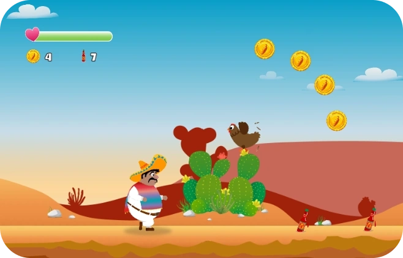
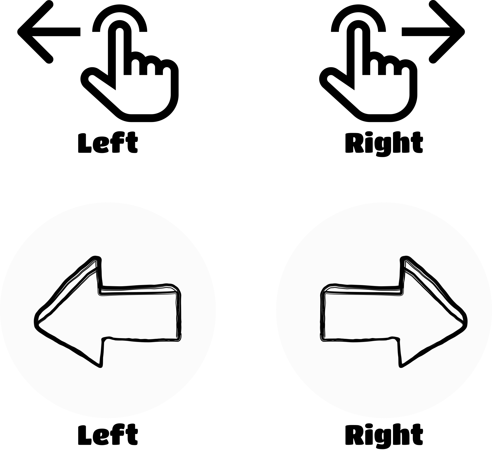
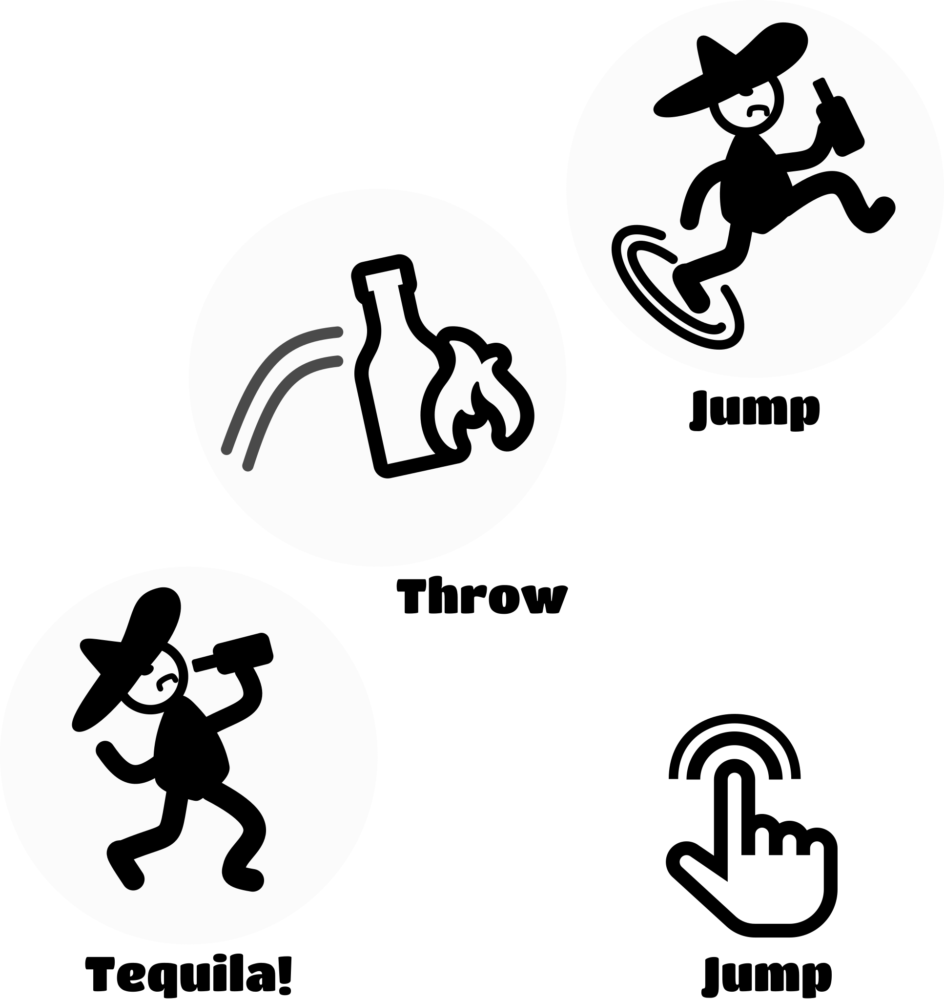

# El Pollo Loco

    Jump, run and throw game based on object-oriented approach. 
     
    Help Pepe to find coins and tabasco salsa to fight against the crazy hen.
     
    <strong>Is your salsa prepared, cabrón?</strong>

<a href="https://el-pollo-loco.svenprimus.com/" target="_blank">Try it out → VAMOS!</a>

#

<i align="left">
    Old Don Pepe had a rancho, 
    Ei-Ai-Ei-Ay-Ó! 
     
    And on that rancho he had some gallos, 
    Ei-Ai-Ei-Ay-Ó! 
     
    With an "qui-qui" here,  
    And an "ri-ri" there, 
    Here an "qui-qui", there an "ri-quí" 
    Everwhery "¡Qui-qui-ri-quí!" 
     
    Old Don Pepe had a rancho, 
    Ei-Ai-Ei-Ay-Ó! 
<i>

## Controls

<table>
    <tr>
        <td>
            
Desktop

        </td>
        <td>
            
        </td>
        <td>
            
        </td>
    </tr>
    <tr>
        <td>
            
Mobile

        </td>
        <td>
            
        </td>
        <td>
            
        </td>
    </tr>
</table>
